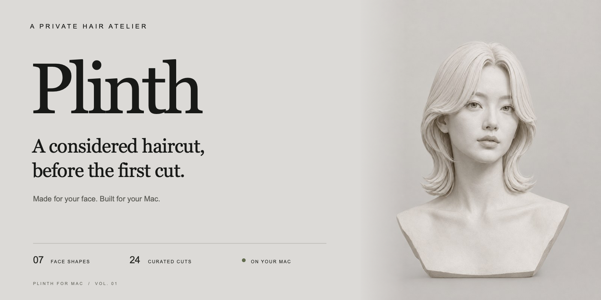
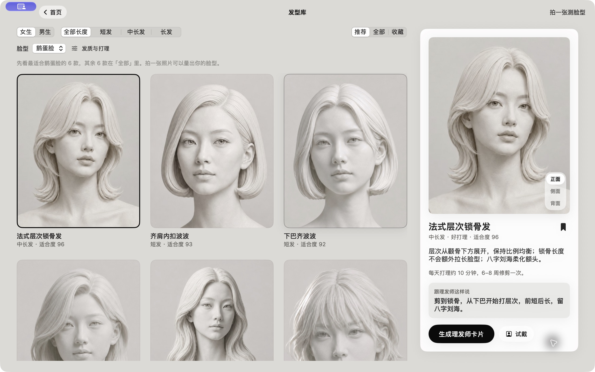
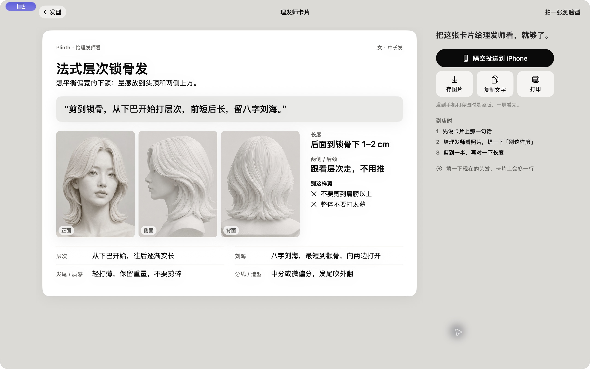

<p align="center">
  
</p>

<p align="center">
  <strong>Find your next haircut before the first cut.</strong><br>
  A native Mac app for understanding your face, exploring hairstyles, and bringing a clear brief to your barber.
</p>

<p align="center">
  
  
  
  
</p>

<p align="center">
  <a href="README.md">简体中文</a> · English<br><br>
  <a href="#the-experience">The experience</a> &nbsp; / &nbsp;
  <a href="#get-started">Get started</a> &nbsp; / &nbsp;
  <a href="#on-your-mac">On your Mac</a> &nbsp; / &nbsp;
  <a href="docs/DEVELOPMENT.zh-CN.md">Technical notes · 中文</a>
</p>

---

## A more considered change

A folder full of haircut references still leaves a lot to explain in the chair.

Plinth connects the steps: understand your proportions from a photo, compare sculptural hairstyle references, preview a change locally, and turn the details into a card your barber can use.

The interface takes its cues from a quiet sculpture gallery: stone tones, plaster busts, and space to look closely.

<p align="center">
  
</p>

<table>
  <tr>
    <td align="center" width="25%"><strong>7</strong><br><sub>face shape references</sub></td>
    <td align="center" width="25%"><strong>24</strong><br><sub>hairstyles · 12 per collection</sub></td>
    <td align="center" width="25%"><strong>3</strong><br><sub>views of every cut</sub></td>
    <td align="center" width="25%"><strong>On device</strong><br><sub>photo analysis and try-on</sub></td>
  </tr>
</table>

## The experience

**01 / Understand your proportions.** Import a front-facing photo or use the Mac camera. Apple Vision landmarks and hair segmentation measure the forehead, cheekbones, jaw, and face length against seven reference shapes. Close results retain several possibilities; you can also confirm a shape yourself or browse without a photo.

**02 / Consider the whole haircut.** Explore 24 styles with front, side, and back references. Filter by length and save favorites. Add your hair density, strand thickness, natural texture, and daily styling budget to refine recommendations. Every style includes reasons, upkeep, and a sentence to start the conversation.

<p align="center">
  
</p>

**03 / See the change locally.** A segmented, geometrically aligned draft establishes the hairstyle. With the optional Core ML inpainting model installed, Plinth redraws hair, the hairline, and sideburns on your Mac. Explore hair colors with rule-based undertone and bleaching guidance. The model is about 2 GB and requires a separate installation; without it, previews use compositing. Some styles offer references instead of try-on. Previews are illustrative and can differ from the final cut or color.

**04 / Take a useful brief to the chair.** A barber card combines three views with length, layers, fringe, sides, neckline, texture, styling, and things to avoid. Save a phone-friendly image, copy the text, print, or AirDrop it to iPhone. Multiple saved styles can share a comparison sheet.

<p align="center">
  
</p>

**05 / Keep the next trim in view.** The menu bar tracks your current style and trim cycle, with optional reminders. Drop a photo onto the icon to analyze it. Your last result stays on the Mac, and favorites carry across analyses.

## Get started

Requires **macOS 14+** and Xcode with a **Swift 6.0 toolchain**. The current interface is Simplified Chinese and light mode. Realistic try-on has primarily been exercised on Apple Silicon.

```bash
git clone https://github.com/Jul11us/Plinth.git
cd Plinth

# Run in development
swift run

# Build and open the native app
./scripts/build-app.sh
open build/Plinth.app

# Create a drag-to-install disk image
./scripts/build-dmg.sh

# Run the tests
swift test -c release
```

You can also open `Package.swift` in Xcode. The product is called **Plinth**; its Swift package, module, and source directory retain the original name, **FitHair**.

This repository provides source; the scripts build installers locally using ad-hoc signing. Developer ID signing and notarization are not configured. Optional model installation, bundled installers, and first-run model downloads are covered in the [technical notes](docs/DEVELOPMENT.zh-CN.md#写实试戴的模型).

## On your Mac

| Layer | Implementation |
| :--- | :--- |
| Native experience | SwiftUI, AppKit, menu bar, system sharing |
| Capture and landmarks | AVFoundation and Apple Vision |
| Hair and skin segmentation | Bundled MediaPipe model converted to Core ML |
| Recommendations | Inspectable proportion rules, reference shapes, hairstyle scores |
| Draft try-on | Segmentation, geometry, masks, color processing |
| Optional realistic rendering | DreamShaper 8 Inpainting converted to Core ML |
| Model installation | Resume support, SHA-256 verification, archive validation, atomic install |

Photo analysis and try-on run locally. The last photo and its measurements are stored in `~/Library/Application Support/Plinth/LastResult` and can be deleted from the home screen. A configured model download starts only when you request it.

## Inside the repository

```text
Sources/FitHair/
├── App/           # State, windows, and the last result
├── Analysis/      # Landmarks, classification, segmentation, try-on, downloads
├── Camera/        # Camera sessions, countdowns, and burst capture
├── Model/         # Face shapes, styles, preferences, and trim cycles
├── Resources/     # Hairstyle references, face shapes, and segmentation model
├── Support/       # Visual theme, hair lettering, and menu bar
└── Views/         # Home through barber card
Tests/             # Classification, recommendations, rendering, downloads, state
Support/           # App metadata and third-party model licenses
scripts/           # App / DMG builds, model packaging, conversion
docs/              # Technical notes, screenshots, and asset prompts
```

## An early version, with room to improve

Face-shape rules are calibrated against seven reference busts; **accuracy has not been validated against a labeled dataset of real faces**. Hair-care and styling advice uses heuristic rules. Fine fringes, larger head rotations, old hair crossing the face, and reconstructed backgrounds remain challenging for try-on.

Implementation details, known limitations, performance observations, and instructions for adding styles are preserved in the [technical notes](docs/DEVELOPMENT.zh-CN.md).

## Acknowledgments and licensing

- **Apple Vision / Core ML / SwiftUI** power landmarks, local inference, and the native experience.
- **Google MediaPipe** provides the bundled segmentation model under Apache 2.0. See its [license](Sources/FitHair/Resources/HairSegmenter-LICENSE-Apache-2.0.txt) and [notice](Sources/FitHair/Resources/HairSegmenter-NOTICE.txt).
- **Lykon · DreamShaper 8 Inpainting** powers optional realistic try-on under CreativeML Open RAIL-M. See its [license](Support/RepaintModel-LICENSE.txt) and [notice](Support/RepaintModel-NOTICE.txt). Inpainting weights are not included in this source repository.

No open-source license has been selected for the project code. Third-party models retain their own licenses.

---

<p align="center">
  <strong>Plinth</strong><br>
  <sub>A considered haircut, before the first cut.</sub><br>
  <sub>Built for Mac. Kept on your Mac.</sub>
</p>
