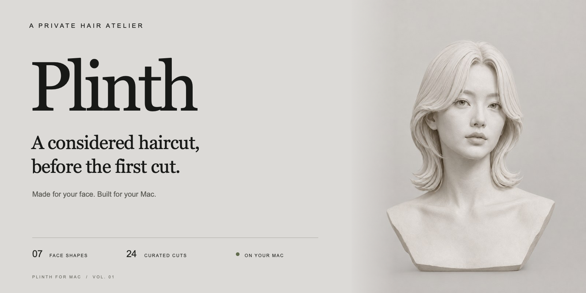
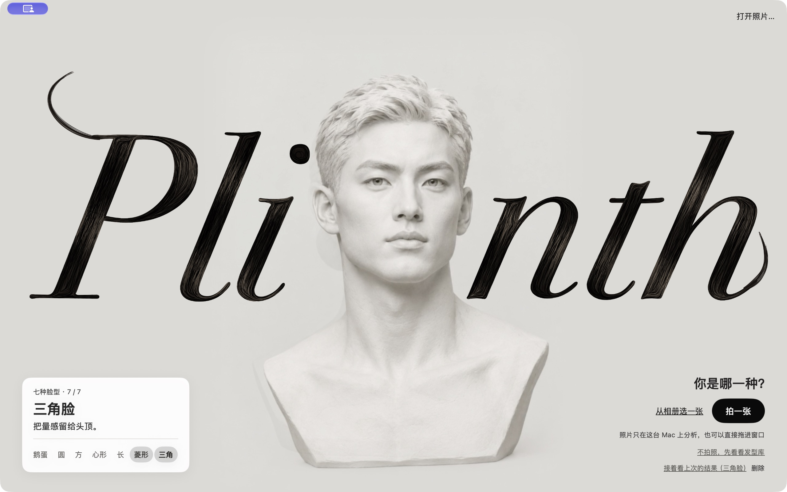
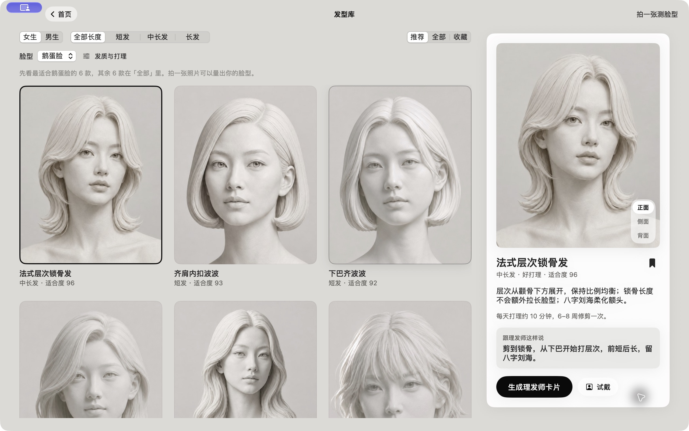
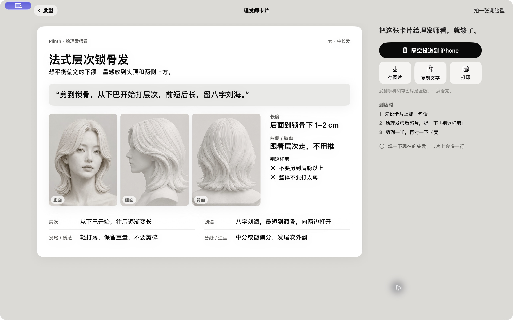

<p align="center">
  
</p>

<p align="center">
  <strong>先看见适合你的样子，再剪下第一刀。</strong><br>
  为 Mac 而做的私人发型顾问。从理解脸型，到把想法交给理发师。
</p>

<p align="center">
  
  
  
  
</p>

<p align="center">
  简体中文 · <a href="README.en.md">English</a><br><br>
  <a href="#体验">体验</a> &nbsp; / &nbsp;
  <a href="#开始使用">开始使用</a> &nbsp; / &nbsp;
  <a href="#本机上的智能">本机上的智能</a> &nbsp; / &nbsp;
  <a href="docs/DEVELOPMENT.zh-CN.md">开发文档</a>
</p>

---

## 一次有依据的改变

收藏了很多发型照片，到了理发店，还是只说得出「剪短一点」。

Plinth 把这段距离变短：一张正脸照片，理解面部比例；一组石膏发型，比较轮廓与层次；一次本地试戴，看看变化；最后，把长度、刘海、两侧和发尾写成一张能带到店里的卡片。

界面像一间安静的雕塑展厅。米白底色、石膏胸像、克制的排版，让注意力留在脸型和头发本身。

<p align="center">
  
</p>

<table>
  <tr>
    <td align="center" width="25%"><strong>7</strong><br><sub>种脸型参考</sub></td>
    <td align="center" width="25%"><strong>24</strong><br><sub>款发型 · 男女各 12 款</sub></td>
    <td align="center" width="25%"><strong>3</strong><br><sub>个视角 · 正面 / 侧面 / 背面</sub></td>
    <td align="center" width="25%"><strong>本机处理</strong><br><sub>照片分析与 AI 试戴</sub></td>
  </tr>
</table>

## 体验

### 01 / 先理解比例

从相册选择照片，或用 Mac 摄像头拍摄。Apple Vision 提取面部关键点，结合头发与皮肤分割，测量额头、颧骨、下颌和脸长，比较七种脸型：鹅蛋、圆、方、心形、长、菱形、三角。

判断接近时，会保留几种可能并一起推荐。你也可以手动确认脸型，或者直接进入发型库慢慢看。

### 02 / 找到适合，也适合日常的发型

24 款发型以统一的石膏胸像呈现，每款都有正面、侧面和背面。按脸型、长度和收藏筛选，再填入发量、发丝粗细、天生卷度与每天愿意花的打理时间，让推荐更贴近生活。

每款都解释为什么适合、需要怎样打理，以及到店可以怎么说。

<p align="center">
  
</p>

### 03 / 在自己的照片上看看

先用本地几何变形和分割建立发型草图；安装可选的 Core ML 重绘模型后，再重新绘制头发、发际线和鬓角，提供更自然的试戴预览。还可以切换发色，参考肤色冷暖和漂发说明。

写实模型约 2 GB，需单独安装。未安装时提供贴图示意；部分尚不适合试戴的发型直接展示参考图和卡片入口。效果用于沟通与参考，细节可能与真实剪染结果不同。

### 04 / 把想法交给理发师

把「想要这种感觉」写成可以讨论的细节：长度、层次、刘海、两侧与后颈、发尾质感、分线与造型，还有「别这样剪」。

一张卡片带上三个角度。可存成手机长图、复制文字、打印，或通过隔空投送带到 iPhone；收藏多款时，还可以合成一张对照卡。

<p align="center">
  
</p>

### 05 / 下次修剪，也记得

菜单栏随时查看当前发型和修剪周期，记录「今天剪了」，按需开启到期提醒。把照片拖到菜单栏图标即可开始分析。最近一次结果保存在本机，收藏会跨分析保留。

## 开始使用

需要 **macOS 14 或更新版本**，以及带 Swift 6.0 工具链的 Xcode。界面目前为简体中文、浅色外观；写实试戴的本机体验以 Apple Silicon 为主。

```bash
git clone https://github.com/Jul11us/Plinth.git
cd Plinth

# 开发运行
swift run

# 打包原生应用，再打开
./scripts/build-app.sh
open build/Plinth.app

# 制作可拖入「应用程序」的安装包
./scripts/build-dmg.sh

# 运行测试
swift test -c release
```

也可以用 Xcode 打开 `Package.swift`。应用名为 **Plinth**；Swift Package、模块和源码目录沿用原名 **FitHair**。

当前仓库提供源码，安装包由上述脚本在本机构建。脚本使用临时签名，尚未做 Developer ID 签名和公证。写实模型的安装、打包与首次下载配置，见[开发文档](docs/DEVELOPMENT.zh-CN.md#写实试戴的模型)。

## 本机上的智能

| 环节 | 实现 |
| :--- | :--- |
| 原生界面 | SwiftUI、AppKit、菜单栏与系统分享 |
| 拍照与关键点 | AVFoundation、Apple Vision |
| 头发与皮肤分割 | MediaPipe 模型转换为 Core ML，随应用附带 |
| 脸型与推荐 | 可检查的比例规则、七种参考脸型与发型评分 |
| 发型草图 | 图像分割、几何对齐、遮罩与发色处理 |
| 可选写实试戴 | DreamShaper 8 Inpainting 转换为 Core ML，在本机推理 |
| 模型安装 | 暂停与续传、SHA-256 校验、解压检查与原子安装 |

照片分析和试戴都在 Mac 上执行。最近一次照片与测量结果保存在 `~/Library/Application Support/Plinth/LastResult`，可从首页删除。配置好模型下载地址后，应用只在你点击下载时获取模型。

## 项目结构

```text
Plinth/
├── Sources/FitHair/
│   ├── App/           # 应用状态、窗口与最近一次结果
│   ├── Analysis/      # 脸型分析、分割、试戴、发色与模型下载
│   ├── Camera/        # 摄像头、倒计时与连拍
│   ├── Model/         # 脸型、发型、发质偏好与修剪周期
│   ├── Resources/     # 24 款发型三视图、脸型图与分割模型
│   ├── Support/       # 视觉主题、发丝字样与菜单栏
│   └── Views/         # 首页到理发师卡片的完整流程
├── Tests/             # 分类、推荐、渲染、下载与状态测试
├── Support/           # 应用配置与第三方模型许可
├── assets/            # 应用图标
├── scripts/           # 应用构建、DMG、模型打包与转换
└── docs/              # 开发说明、展示图与素材提示词
```

## 认真保留的不确定性

Plinth 正处于早期版本。脸型规则按七张参考石膏像校准，**尚未通过人工标注的真人数据集验证准确率**；发质与打理建议来自经验规则。写实试戴对细碎刘海、大幅转头、旧发遮挡等情况仍有局限，被旧头发遮住的背景也可能被重新生成。

更完整的实现细节、已知问题、性能观察和扩充发型的方法，都保留在[开发文档](docs/DEVELOPMENT.zh-CN.md)。

## 致谢与许可

- **Apple Vision / Core ML / SwiftUI** — 面部关键点、本机模型运行与原生界面。
- **Google MediaPipe** — 随应用分发的头发分割模型按 Apache 2.0 许可提供，见[许可全文](Sources/FitHair/Resources/HairSegmenter-LICENSE-Apache-2.0.txt)与[来源说明](Sources/FitHair/Resources/HairSegmenter-NOTICE.txt)。
- **Lykon · DreamShaper 8 Inpainting** — 可选写实试戴模型，受 CreativeML Open RAIL-M 许可约束，见[许可全文](Support/RepaintModel-LICENSE.txt)与[来源说明](Support/RepaintModel-NOTICE.txt)。重绘权重不包含在源码仓库中。

项目代码目前尚未指定开源许可证；第三方模型分别遵循各自许可。

---

<p align="center">
  <strong>Plinth</strong><br>
  <sub>A considered haircut, before the first cut.</sub><br>
  <sub>Built for Mac. Kept on your Mac.</sub>
</p>
